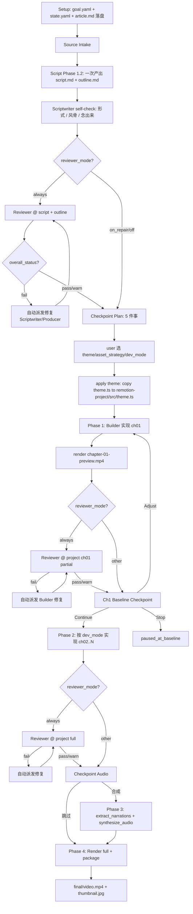

# 技术方案设计 — video-maker-v2 Harness Upgrade (v2.1)

## 0. 设计前提

### 0.1 已采纳的推荐答案

| Q | 决策 |
|---|---|
| 主题数量 | **5 套**内置（覆盖深色电影 / 报刊 / 现代主义 / 终端 / 印刷），后续可扩展 |
| TTS 默认 | **`mmx`** 优先，未安装时降级 `qwen3`（沿用现有 `qwen3_tts_scene.py`） |
| 契约形式 | **保留 `script-contract.json`** —— chapters 字段并入；不替换为纯 outline |
| Primitive 组件 API | **React Functional Component + props** —— 不引入 styled-system |
| 三层降级 → 二档 | **Task spawn → 当前 agent 自检** 两档；不引入 LangGraph supervisor |

### 0.2 整体策略

把 `web-video-presentation` 的成熟方法论**移植到 Remotion 渲染管线**：

- **方法论原文照搬**：双源原则、SCRIPT-STYLE、信息池、5-in-1 Checkpoint、3 模式、Ch1 Baseline、修复后汇报铁律
- **Web 运行时机制翻译为 Remotion 等价物**：step 计数器 → `<Sequence>` 链；`narrations.ts` 真相源 → 同时驱动音频/scene 数/字幕/`durationInFrames`；Auto 录屏 → Remotion deterministic render（不需要）
- **CSS Tokens 翻译为 React Tokens**：`tokens.css` → `theme.ts` 导出 token 对象；CSS primitive class → React primitive 组件

---

## 1. 整体架构

### 1.1 v2.1 工作流总览

```
Phase 1 内容编写
  1.1 Setup（goal.yaml + state.yaml + article.md 落盘）
  1.2 一次产出 script.md + outline.md（含 self-check）
  ▼
[Reviewer @ script + outline]（reviewer_mode != off）
  ▼
[Checkpoint Plan]（硬节点）→ 5 件事一次对齐
  ▼
Phase 2 Remotion 项目实现
  2.1 脚手架 + 主题应用（apply theme.ts → tokens, primitive 组件挂载）
  2.2 第 1 章 Phase 1 实现 + chapter-01-preview.mp4
  ▼
[Reviewer @ project Ch1 partial]
  ▼
[Ch1 Baseline Checkpoint]（硬节点）→ Continue / Adjust / Stop
  ▼
  2.3 第 2~N 章 Phase 2 实现（按 dev_mode A/B/C 调度）
  ▼
[Reviewer @ project full]
  ▼
[Checkpoint Audio]（硬节点）→ 是否合成音频
  ▼
Phase 3 音频合成（可选，narrations.ts → segments → mmx/qwen3）
  ▼
Phase 4 Render & Package（Remotion render + ffprobe + thumbnail）
```

### 1.2 v2.1 新增组件清单

| 工件类型 | 路径 | 职责 |
|---|---|---|
| Skill 文档 | `skills/video-maker-v2/SKILL.md` | v2.1 主流程（重写） |
| Skill 文档 | `skills/video-maker-v2/agents/scriptwriter.md` | 强化 SCRIPT-STYLE + 一次出 script+outline（重写） |
| Skill 文档 | `skills/video-maker-v2/agents/remotion-builder.md` | Phase 1/2 + theme + primitive + 章节隔离（重写） |
| Skill 文档 | `skills/video-maker-v2/agents/reviewer.md` | **新增** Reviewer agent prompt |
| Reference | `skills/video-maker-v2/references/script-style.md` | **新增** 信息保留 + 形式 8 + 风骨 5 + 念出来测试 |
| Reference | `skills/video-maker-v2/references/outline-format.md` | **新增** outline.md 人类可编辑 spec |
| Reference | `skills/video-maker-v2/references/chapter-craft.md` | **新增** 章节实现单一入口（10 原则 + 决策树 + 反 AI 味 + 完工自检） |
| Reference | `skills/video-maker-v2/references/themes.md` | **新增** 主题 token 契约 + 创作流程 |
| Reference | `skills/video-maker-v2/references/audio-contract.md` | **重写** 以 narrations.ts 为中心 |
| Reference | `skills/video-maker-v2/references/recording.md` | **新增** Remotion render 与可选预览录屏 |
| 主题资产 | `skills/video-maker-v2/themes/<id>/theme.json` | **新增** 主题元数据 ×5 |
| 主题资产 | `skills/video-maker-v2/themes/<id>/theme.ts` | **新增** Remotion 可 import 的 token 对象 ×5 |
| Ratify Checklist | `skills/video-maker-v2/ratify/reviewer-script-checklist.md` | **新增** 脚本核查清单 |
| Ratify Checklist | `skills/video-maker-v2/ratify/reviewer-outline-checklist.md` | **新增** outline 核查清单 |
| Ratify Checklist | `skills/video-maker-v2/ratify/reviewer-project-checklist.md` | **新增** 项目核查清单 |
| 模板 | `skills/video-maker-v2/templates/remotion/` | **新增** Remotion 项目脚手架 |
| Python 工具 | `src/deepagents_video_maker/langchain_tools.py` | **扩展** 新增 8 个工具 |
| Python 模块 | `src/deepagents_video_maker/outline.py` | **新增** outline.md 解析与 chapters 抽取 |
| Python 模块 | `src/deepagents_video_maker/themes.py` | **新增** 主题列表/匹配/应用 |
| Python 模块 | `src/deepagents_video_maker/reviewer.py` | **新增** Reviewer 报告解析与修复派发 |
| 脚本 | `scripts/extract_narrations.ts` | **新增** 扫所有 narrations.ts → audio-segments.json |
| 脚本 | `scripts/synthesize_audio.sh` | **新增** mmx/qwen3 串行合成 + 断点续合 |

### 1.3 v2.1 工作目录结构

```
output/<timestamp>-video-<slug>/
├── goal.yaml                                # 含 theme/dev_mode/reviewer_mode/...
├── state.yaml                               # 含 reviewer_runs/reviewer_repair_log/chapters[]
├── article.md                               # ★ 持久保留（双源原则）
├── artifacts/
│   ├── source/source-manifest.md
│   ├── outline.md                           # ★ 人类可编辑（章节切分 + 信息池）
│   └── script/run-1/
│       ├── script-contract.json
│       └── script.md
├── ratify/
│   ├── reviewer-script-run-1.json           # ★ 新增
│   ├── reviewer-outline-run-1.json          # ★ 新增
│   └── reviewer-project-run-1.json          # ★ 新增
├── remotion-project/
│   ├── package.json
│   ├── src/
│   │   ├── theme.ts                         # ★ 主题 token（从 themes/<id>/theme.ts 复制）
│   │   ├── primitives/                      # ★ HeroNum/Rule/Card/StageFrame/MaskReveal
│   │   ├── components/                      # SubtitleOverlay 等共享组件
│   │   ├── chapters/<NN>-<id>/              # ★ 物理隔离
│   │   │   ├── <Chapter>.tsx
│   │   │   ├── <Chapter>.module.css
│   │   │   └── narrations.ts                # ★ 单一真相源
│   │   ├── registry/chapters.ts             # 唯一允许跨章引用的注册表
│   │   ├── Root.tsx
│   │   └── index.ts
│   ├── public/audio/<id>/<step+1>.mp3       # ★ 由 mmx/qwen3 合成
│   ├── audio-segments.json                  # extract_narrations 产出
│   └── out/
│       ├── chapter-01-preview.mp4           # ★ Phase 1 产出
│       └── video.mp4                        # Phase 2 完整产出
└── final/
    ├── video.mp4
    └── thumbnail.jpg
```

---

## 2. 数据流（Mermaid）



---

## 3. 文件 Schema

### 3.1 `goal.yaml` v2.1（完整 schema）

```yaml
# 既有 v2.0 字段
topic: "<topic>"
source: folder | manual | websearch | notebooklm | local-file
duration: 1-3min | 3-5min | 5-10min
style: professional | casual | storytelling
aspectRatio: 16:9 | 9:16 | 3:4 | 1:1
lut_style: <inferred>
visual_strategy: <inferred>
fps: 30
width: <inferred>
height: <inferred>
target_scene_count: { min, max }
target_duration_seconds: { min, max }

# v2.1 新增
theme: midnight-press | newsroom | bauhaus-bold | terminal-green | monochrome-print
dev_mode: chapter_by_chapter | sequential | parallel
parallel_max_concurrency: 4                    # 仅 dev_mode=parallel
chapter_baseline_review: enabled | skip
baseline_preview_quality: medium | low
reviewer_mode: always | on_repair | off
dual_source_mode: enabled | script_only        # auto-init based on article.md
asset_strategy: pick_existing | user_provides | placeholders
tts_provider: mmx | qwen3 | custom
```

### 3.2 `state.yaml` v2.1（增量字段）

```yaml
# 既有字段保留...

# v2.1 新增
compat_mode: v2.0 | null
applied_defaults: [theme, dev_mode, reviewer_mode, ...]
dual_source_mode: enabled | script_only

milestones:
  - id: build_scenes
    status: pending | in_progress | completed | paused
    baseline_review: not_required | pending | approved | paused
    baseline_review_run: 1
    dev_mode_used: chapter_by_chapter | sequential | parallel

reviewer_runs:
  - checklist: script | outline | project
    run_number: 1
    overall_status: pass | warn | fail
    report_path: ratify/reviewer-script-run-1.json

reviewer_repair_log:
  - reviewer_run: 1
    fail_items: [script.no_ai_taste, script.information_retention]
    dispatched_agent: scriptwriter
    repair_run: 2
    final_status: pass | fail | accepted_by_user

chapters:                                      # 多章节追踪
  - id: ch01
    status: pending | in_progress | completed
    build_run: 1
    last_subagent_id: <task_id>
    isolation_check: pass | fail
```

### 3.3 `script-contract.json` v2.1

```json
{
  "version": "2.1",
  "topic": "...",
  "duration": "1-3min",
  "target_scene_count": { "min": 10, "max": 16 },
  "target_duration_seconds": { "min": 60, "max": 180 },
  "chapters": {
    "min_count": 2,
    "max_count": 4,
    "expected_titles": null,
    "naming_rule": "lowercase-hyphenated"
  },
  "constraints": {
    "max_consecutive_same_type": 3,
    "audio_scene_types": ["narration", "data_card", "quote_card", "diagram_walkthrough"],
    "information_retention_min": 0.6,
    "ai_taste_word_threshold": 3
  }
}
```

### 3.4 `outline.md`（人类可编辑 markdown）

```md
# Video Outline

> **主题**：`midnight-press` —— 电影感编辑级深色，火热橙 accent
> **总时长**：约 2 分 30 秒（口播 ~600 字 ÷ 4 字/秒）
> **章节数**：3 章 / 14 步

---

## 1. coldopen — 钩子开场（3 steps · ~12s）

**信息池**（chapter agent 按需挂角标 / 副标 / pull-quote / mono cue）：
- 数字：3 秒钩子 —— 来源 article §1 / L3
- 反差：以前要 3 小时，现在 30 秒 —— 来源 article §2 / L8
- 出处：Anthropic blog 2025-08 —— 来源 article §1 / L1

**开发计划**：

- step 1 (~3s) — hero 标语 + kicker
- step 2 (~5s) — 具体数字反差（hero number "3s" vs "3h"）
- step 3 (~4s) — 引用 + 出处

口播节选：
> 以前要 3 小时的事情，现在 3 秒搞定。

---

## 2. how-it-works — 怎么做到的（6 steps · ~36s）

**信息池**：
- 流程：拆分章节 → 每章 outline → 每步开发 → 完工自检 —— 来源 article §3
- ...

**开发计划**：
- step 1 (~5s) — 流程总览（4 节点）
...

口播节选：
> 整个套路其实就四步。先拆章节，然后每章排个开发计划，再一步步落实，最后过自检。

---

## 3. why-it-matters — 为什么重要（5 steps · ~25s）

...

---

## 素材清单

### 1. coldopen
- ⚠️ hero 数字字体（已就位 theme.ts）
- ✓ Anthropic blog screenshot（待提供）

### 2. how-it-works
- ⚠️ 流程图 SVG（用 placeholder）

...
```

**禁止**写入 `outline.md` 的内容（由 outline ratify 检查）：

- 动画类型词（`fade` / `blur` / `wipe` / `slide` / `spring` / `interpolate`）
- 实现手段词（`filter` / `clip-path` / `transform` / `keyframes` / `Sequence` / `Composition`）
- 时长数值（`200ms` / `1.5s` / `30 帧`）（仅允许 `(~Ts)` 估时）
- 错峰量（`stagger` / `delay 80ms`）
- keyframe 数值

### 3.5 `narrations.ts` 单一真相源 schema

```typescript
// remotion-project/src/chapters/01-coldopen/narrations.ts
import type { Narration } from "../../registry/types";

export const narrations: Narration[] = [
  {
    step: 0,
    text: "以前要 3 小时的事情，现在 3 秒搞定。",
    durationInFrames: 90,  // optional: explicit override (30fps × 3s)
  },
  {
    step: 1,
    text: "你没听错，是 3 秒。",
  },
  {
    step: 2,
    text: "",  // 空字符串 = 无音频过场，时长由字数估时退化
  },
];
```

**约束**：
- `narrations.length === maxStepN + 1`（章节代码 `if (step === N)` 出现的最大 N + 1）
- 文本与 `script.md` 对应段落语义一致
- 完全无音频的过场用 `""`

### 3.6 `theme.json` schema

```json
{
  "id": "midnight-press",
  "nameZh": "午夜印刷",
  "nameEn": "Midnight Press",
  "descriptionZh": "电影感编辑级深色。暖 espresso（不是纯黑）+ 火热橙。Instrument Serif italic 英文 vs Noto Serif SC 中文。慢速电影感节奏。",
  "mood": "cinematic",
  "bestFor": ["技术讲解", "深度内容", "深色冷峻", "电影感"],
  "palette": {
    "shell": "#1a0f0a",
    "surface": "#241612",
    "accent": "#ff6b35"
  },
  "fontDisplay": "Instrument Serif",
  "fontBody": "Noto Serif SC",
  "fontMono": "JetBrains Mono",
  "stagePadding": "140px 100px",
  "cardRadius": 4,
  "ruleStyle": "1px solid"
}
```

### 3.7 `theme.ts` schema（Remotion 可 import）

```typescript
// skills/video-maker-v2/themes/midnight-press/theme.ts
export const theme = {
  // 颜色（必须用 token，章节禁硬编码）
  colors: {
    shell: "#1a0f0a",
    surface: "#241612",
    surface2: "#2e1d18",
    surface3: "#3a261f",
    text: "#f5e6d3",
    text2: "#c9b8a3",
    textMute: "#8a7765",
    textFaint: "#5a4a3e",
    rule: "#3a261f",
    accent: "#ff6b35",
    accentSoft: "rgba(255, 107, 53, 0.4)",
    accentGlow: "rgba(255, 107, 53, 0.15)",
  },
  // 字体家族（必须用 token）
  fonts: {
    display: '"Instrument Serif", serif',
    displayCn: '"Noto Serif SC", serif',
    body: '"Noto Serif SC", serif',
    mono: '"JetBrains Mono", monospace',
  },
  // 性格 token（primitive 组件消费）
  personality: {
    heroNumStyle: "italic-serif",  // primitive 组件根据此值切换实现
    ruleWidth: 1,
    ruleStyle: "solid",
    cardRadius: 4,
    cardShadow: "0 8px 32px rgba(0, 0, 0, 0.4)",
    stageRadius: 8,
    stageVignette: true,
    stagePattern: null,
  },
  // 节奏气质（章节自由发挥时参考）
  mood: {
    name: "cinematic",
    revealDurationHint: 1600,  // ms
    pacingHint: "slow",
    overshootAllowed: false,
  },
  // 舞台尺寸
  stage: {
    paddingX: 140,
    paddingY: 100,
  },
} as const;

export type Theme = typeof theme;
```

### 3.8 `reviewer-*.json` 报告 schema

```json
{
  "checklist_id": "script" | "outline" | "project",
  "run_number": 1,
  "started_at": "2026-05-09T17:35:00Z",
  "finished_at": "2026-05-09T17:36:30Z",
  "overall_status": "pass" | "warn" | "fail",
  "items": [
    {
      "id": "script.information_retention",
      "category": "fidelity",
      "status": "fail",
      "evidence": "len(script.md)=420, len(article.md)=850, ratio=0.49 < 0.6",
      "suggested_fix": "Scriptwriter 重写时回原文章补回数字 / 案例 / 论证链；不要靠压缩硬塞。"
    }
  ],
  "auto_repair_attempted": true,
  "auto_repair_dispatched_to": "scriptwriter"
}
```

---

## 4. 主题系统设计

### 4.1 5 套内置主题（v2.1 初始集）

| id | 性格 | bestFor |
|---|---|---|
| `midnight-press` | 电影感深色，暖 espresso + 火热橙，斜体衬线 hero | 技术讲解 / 深度内容 / 深色冷峻 |
| `newsroom` | NYT 报刊浅色，墨黑衬线 + 旗红，0 圆角 | 新闻资讯 / 严肃测评 / 印刷感 |
| `bauhaus-bold` | 现代主义，米白 + 墨黑 + 原色蓝，4px 厚边 | 产品发布 / 宣言 / 设计感 |
| `terminal-green` | 80 年代终端，纯黑 + 磷光绿，CRT 扫描线 | 编程教程 / Hacker / 复古科幻 |
| `monochrome-print` | 安静精炼印刷，米白 + 墨黑衬线 + 1px 发丝线 | 文化历史 / 阅读分享 / 极简 |

### 4.2 Primitive 组件 API（FC + props）

```typescript
// remotion-project/src/primitives/HeroNum.tsx
import { theme } from "../theme";

interface HeroNumProps {
  children: React.ReactNode;
  size?: number;  // px, default 280
}

export function HeroNum({ children, size = 280 }: HeroNumProps) {
  // 根据 theme.personality.heroNumStyle 切换实现：
  //   "italic-serif" → Instrument Serif italic
  //   "mono-bold"    → JetBrains Mono 900
  //   "black"        → Inter font-weight 900
  //   "tabular"      → Source Serif italic tabular-nums
  const styleVariant = theme.personality.heroNumStyle;
  // ...
  return <div className={`hero-num hero-num-${styleVariant}`} style={{ fontSize: size }}>{children}</div>;
}
```

类似地：

- `<Rule />` —— props: `weight?, style?`，根据 `theme.personality.ruleStyle` 渲染
- `<Card>{children}</Card>` —— props: `padding?, elevation?`，根据 `theme.personality.cardRadius/Shadow`
- `<StageFrame>{children}</StageFrame>` —— 包裹整个 Composition，应用 padding + vignette + pattern
- `<MaskReveal>{children}</MaskReveal>` —— props: `delay?, duration?`，使用 Remotion `interpolate` 实现遮罩揭示

### 4.3 章节代码层 token 消费规则（写入 `chapter-craft.md`）

**必须用 token**：

- 颜色：`theme.colors.text` / `accent` / ...（**禁硬编码 hex / rgb / 颜色名**）
- 字体家族：`theme.fonts.display` / `body` / `mono`（**禁硬编码字体名**）

**章节自由发挥**：

- 字号：`80px` 直接写
- padding/margin：按构图节奏
- 动画时长/缓动：参考 `theme.mood.revealDurationHint` 但可自由发挥
- 边框宽度 / gap / 字距

**Reviewer 项目清单 grep 规则**：

```bash
# 命中 fail
grep -r "color:\s*#[0-9a-fA-F]" remotion-project/src/chapters/
grep -r "rgb\(" remotion-project/src/chapters/
grep -r "fontFamily:\s*['\"][^'\"]*['\"]" remotion-project/src/chapters/  # 字体硬编码
```

---

## 5. narrations.ts 单一真相源机制

### 5.1 5 层不漂移保证

```
script.md         —— 人类可读口播稿（节拍源）
  ↓ Phase 1.2
outline.md        —— 章节切分 + step 数初步规划
  ↓ Phase 2.2
narrations.ts     —— 单一真相源（每章一个文件）
  ↓ 自动派生
├── chapters.ts          —— 注册章节（id + Component + narrations 数组引用）
├── <Chapter>.tsx        —— 通过 step prop 渲染（受 narrations.length 约束）
├── audio-segments.json  —— extract_narrations 产出
└── public/audio/<id>/<step+1>.mp3  —— synthesize_audio 产出
```

### 5.2 Remotion `<Sequence>` 链推导

`<Chapter>.tsx` 内的实现模式：

```tsx
// remotion-project/src/chapters/01-coldopen/Coldopen.tsx
import { Sequence, useCurrentFrame, useVideoConfig } from "remotion";
import { narrations } from "./narrations";
import { theme } from "../../theme";
import { HeroNum, Rule } from "../../primitives";
import styles from "./Coldopen.module.css";

interface ColdopenProps {
  audioManifest?: AudioManifest;
}

export function Coldopen({ audioManifest }: ColdopenProps) {
  const { fps } = useVideoConfig();
  return (
    <>
      {narrations.map((n, idx) => {
        const durationInFrames = deriveDuration(n, audioManifest, fps);
        return (
          <Sequence key={idx} from={cumulativeFrames(idx)} durationInFrames={durationInFrames}>
            <ColdopenStep step={n.step} />
          </Sequence>
        );
      })}
    </>
  );
}

function ColdopenStep({ step }: { step: number }) {
  if (step === 0) return <CoverScene />;
  if (step === 1) return <HeroNumberScene />;
  if (step === 2) return <QuoteScene />;
  return null;  // unreachable due to narrations.length 约束
}
```

`deriveDuration` 函数（共享 `src/utils/duration.ts`）：

```typescript
function deriveDuration(n: Narration, manifest: AudioManifest | undefined, fps: number): number {
  // 1. 优先：audio-manifest 中实测时长 + 6 帧（200ms）缓冲
  if (manifest?.[n.step]?.measuredFrames) {
    return manifest[n.step].measuredFrames + 6;
  }
  // 2. 次优：narrations.ts 中显式 durationInFrames
  if (n.durationInFrames) return n.durationInFrames;
  // 3. 兜底：字数估时（中文 ~ 4 字/秒 = 7.5 帧/字 @ 30fps）
  if (!n.text) return 45;  // 1.5s 静默
  return Math.max(45, Math.round(n.text.length * 7.5));
}
```

### 5.3 Audio 合成流程

```bash
# Phase 3 - Step 1: extract
cd remotion-project
pnpm exec tsx scripts/extract-narrations.ts
# → audio-segments.json:
# [
#   { "chapter": "coldopen", "step": 0, "text": "...", "audio": "coldopen/1.mp3" },
#   ...
# ]

# Phase 3 - Step 2: synthesize（按 tts_provider 选择）
bash scripts/synthesize-audio.sh
# 内部逻辑：
#   if which mmx → 调 mmx speech synthesize（断点续合）
#   elif which python && qwen3_tts_scene.py → 调 qwen3 fallback
#   else → 询问用户接入自定义 TTS

# Phase 3 - Step 3: measure（更新 audio-manifest.json）
ffprobe -v error -show_entries format=duration -of csv=p=0 \
  remotion-project/public/audio/<id>/<step>.mp3
```

`audio-manifest.json` schema：

```json
{
  "coldopen": {
    "0": { "audio_path": "audio/coldopen/1.mp3", "measuredSeconds": 3.2, "measuredFrames": 96 },
    "1": { "audio_path": "audio/coldopen/2.mp3", "measuredSeconds": 4.5, "measuredFrames": 135 }
  }
}
```

---

## 6. 组件设计

### 6.1 `agents/scriptwriter.md` v2.1 关键变化

输入变量新增：

```text
{article_file}: {output_dir}/article.md (or null)
{theme_id}: <Checkpoint Plan 之前未确定时为 null>
{output_outline_file}: {output_dir}/artifacts/outline.md
```

工作流变化：

1. **必读** `references/script-style.md`（信息保留度 + 形式 8 + 风骨 5）
2. **必读** `references/outline-format.md`（outline 格式 + 信息池 + 不写动画）
3. **一次产出** `script.md` + `outline.md`（不分两步）
4. **三层自检**（形式 / 风骨 / 念出来）后再交付

输出：
- `{output_dir}/artifacts/script/run-1/script.md`
- `{output_dir}/artifacts/outline.md`

硬规则强化：
- `len(script.md) / len(article.md) ≥ 0.6`（如 article 存在）
- `outline.md` 禁止动画/手段/时长数值
- `## Audio Design` 移至 `outline.md`（与 narrations 配合更紧）

### 6.2 `agents/remotion-builder.md` v2.1 关键变化

输入变量新增：

```text
{theme_file}: {output_dir}/remotion-project/src/theme.ts
{outline_file}: {output_dir}/artifacts/outline.md
{article_file}: {output_dir}/article.md (or null)
{phase}: phase1 | phase2 | full
{chapter_ids}: ["ch01"] | ["ch02", "ch03"] | ["ch01", "ch02", ...]
{dev_mode}: chapter_by_chapter | sequential | parallel
{look_and_feel}: 来自 theme.json descriptionZh / mood / bestFor
```

工作流变化：

- **必读** `references/chapter-craft.md`（单一入口，每章实现前都看）
- **必读** 每章对应 `outline.md` 段落 + `article.md` 对应章节段落（双源）
- **使用 primitive 组件**：HeroNum / Rule / Card / StageFrame / MaskReveal
- **禁止**：硬编码颜色/字体；跨章 import；修改 `chapters.ts` 之外共享文件
- **物理隔离**：每章独立目录 + CSS Modules

Phase 1 / Phase 2 边界（同 v2.0 设计但增强）：

- Phase 1：仅 `chapter_ids[0]`，建立完整 theme + primitive 接入 + Composition + 字幕
- Phase 2：保留 Phase 1 输出（theme.ts、ch01 文件、primitives），扩展剩余章节

### 6.3 `agents/reviewer.md`（新增）

```md
# Role: Independent Reviewer

你是 video-maker-v2 的独立审查代理。**与 Scriptwriter / Remotion Builder
完全隔离**——你不知道他们的对话上下文，只通过文件路径核查产出。

## Inputs

- {checklist_path}: ratify/reviewer-{checklist_id}-checklist.md
- {report_path}: ratify/reviewer-{checklist_id}-run-{run_number}.json
- {output_dir}: 视频项目根目录
- {checklist_id}: script | outline | project
- {run_number}: int

## Read scope

- 仅读取业务工件，不修改：article.md / script.md / outline.md / remotion-project/**
- 仅写入 {report_path}

## Workflow

1. 读取 {checklist_path}，获取本次 checklist 的全部 item id 与核查规则
2. 对每个 item，**仅基于文件实际内容**产生 evidence（最少 1 行实证）
3. 项目清单条目允许执行 `pnpm exec tsc --noEmit`、`grep`、`ffprobe`，不允许执行其他副作用命令
4. 写入 {report_path}（结构化 JSON，schema 见 design.md §3.8）
5. 汇报执行成功/失败给 Producer

## Hard rules

- 禁止"目测一遍就通过"——每项都要 evidence
- 不确定项标 warn，不要标 pass
- 每个 fail 必须给 suggested_fix（一行）
- overall_status 自动推导：任一 fail → fail；无 fail 但有 warn → warn；全 pass → pass

## Forbidden

- 不允许 `edit_file` / `write_file` 到任何业务路径
- 不允许调用 LLM 派发其他子代理（你是终端节点）
- 不允许参考 Scriptwriter / Builder 的中间思考过程
```

### 6.4 Reviewer 修复后汇报机制（Producer 侧逻辑）

```python
# src/deepagents_video_maker/reviewer.py（伪代码）

MAX_AUTO_REPAIR_ROUNDS = 2

def run_reviewer_with_repair_loop(
    output_dir: str,
    checklist_id: str,
) -> ReviewerOutcome:
    for run_n in range(1, MAX_AUTO_REPAIR_ROUNDS + 2):
        report = dispatch_reviewer_subagent(output_dir, checklist_id, run_n)

        if report.overall_status in ("pass", "warn"):
            return ReviewerOutcome(status=report.overall_status, report=report)

        # fail → 自动派发对应代理修复
        if run_n > MAX_AUTO_REPAIR_ROUNDS:
            # 修复了 N 次仍 fail，向用户汇报
            return ReviewerOutcome(
                status="fail_after_max_retries",
                report=report,
                requires_user_decision=True,
            )

        repair_target = {
            "script": "scriptwriter",
            "outline": "producer",  # outline 由 Producer 直接修
            "project": "remotion-builder",
        }[checklist_id]

        dispatch_repair(repair_target, fail_items=report.fail_items)
        # 循环：再跑一次 Reviewer
```

**铁律**：Producer 侧代码与 SKILL.md 都禁止把 fail 报告直接抛给用户而不修复。

---

## 7. LangChain 工具扩展

新增的工具签名：

```python
# src/deepagents_video_maker/langchain_tools.py

@tool
def vm_save_article(output_dir: str, article_text: str | None) -> dict:
    """落盘 article.md（如有）；否则记录 dual_source_mode=script_only。"""

@tool
def vm_dispatch_scriptwriter_v21_task(output_dir: str, run_number: int) -> dict:
    """v2.1 版本：传入 article_file + 要求一次出 script + outline。"""

@tool
def vm_ratify_outline(output_dir: str) -> dict:
    """outline 自动 ratify：禁动画词 / 信息池 ≥ 3 条 / 时长一致 / 章节 3-8 步。"""

@tool
def vm_recommend_themes(output_dir: str, top_k: int = 3) -> dict:
    """读全部 themes/<id>/theme.json，按脚本类型/语气匹配 bestFor 推荐 top_k 套。"""

@tool
def vm_apply_theme(output_dir: str, theme_id: str) -> dict:
    """复制 themes/<theme_id>/theme.ts → remotion-project/src/theme.ts。"""

@tool
def vm_checkpoint_plan(output_dir: str) -> dict:
    """组装 5-in-1 Checkpoint Plan 输出（章节速览 + 主题推荐 + 素材清单 + 模式选项）。"""

@tool
def vm_apply_checkpoint_plan_decision(
    output_dir: str,
    theme_id: str,
    asset_strategy: str,
    dev_mode: str,
) -> dict:
    """把 5-in-1 决策写入 goal.yaml + state.yaml。"""

@tool
def vm_build_remotion_phase_task(
    output_dir: str,
    phase: Literal["phase1", "phase2", "full"],
    chapter_ids: list[str] | None = None,
    feedback: str | None = None,
) -> dict:
    """派发 Builder 任务描述（含 dev_mode 路由）。"""

@tool
def vm_baseline_review_checkpoint(output_dir: str) -> dict:
    """Phase 1 完成后停顿，需配合 block_for_user。"""

@tool
def vm_apply_baseline_decision(
    output_dir: str,
    decision: Literal["continue", "adjust", "stop"],
    feedback: str | None = None,
) -> dict:
    """更新 state.yaml；返回 next-step instruction。"""

@tool
def vm_dispatch_reviewer_with_repair(
    output_dir: str,
    checklist_id: Literal["script", "outline", "project"],
    max_repair_rounds: int = 2,
) -> dict:
    """Reviewer + 自动修复循环（铁律：修复后才汇报用户）。"""

@tool
def vm_extract_narrations(output_dir: str) -> dict:
    """调用 scripts/extract_narrations.ts，产出 audio-segments.json。"""

@tool
def vm_synthesize_audio(
    output_dir: str,
    tts_provider: Literal["mmx", "qwen3", "custom"] = "mmx",
) -> dict:
    """串行合成；mmx 未装 → qwen3；都未装 → 询问用户。"""

@tool
def vm_dispatch_chapter_subagent_parallel(
    output_dir: str,
    chapter_ids: list[str],
    max_concurrency: int = 4,
) -> dict:
    """dev_mode=parallel 时派发多个 chapter subagent。"""
```

---

## 8. 5-in-1 Checkpoint Plan 实现

### 8.1 输出模板

```text
内容计划写完，产出文件：
  📄 article.md   (双源原则保留)
  📄 script.md    {X} 字 / ~{T} 分钟
  📄 outline.md   {N} 章 / {M} 步 + 每章信息池

章节速览：
  1. coldopen      钩子开场       3 步 ~12s
  2. how-it-works  怎么做到的     6 步 ~36s
  3. why-it-matters 为什么重要     5 步 ~25s

接下来一次对齐 5 件事：

  1. 稿子 (script.md) 要不要改？
     可以直接编辑文件，或口头告诉我修改方向。

  2. 开发计划 (outline.md) 要不要改？重点看：
     - 章节切分 / step 数 / 估时是否合理
     - 每步屏幕内容是否清晰
     - 每章首段「信息池」是否有足够 article 细节
     - 末尾素材清单是否完整

  3. 选哪个主题？我的推荐：
     ★ midnight-press — 因为脚本是技术讲解、深色冷峻；电影感编辑级深色 + 火热橙
     ★ newsroom — 适合严肃测评 / 印刷感
     其它可选：bauhaus-bold / terminal-green / monochrome-print
     也可以让我帮你做新主题（详见 references/themes.md）。

  4. 真素材怎么准备？粗看本视频要的图：
     - coldopen: Anthropic blog screenshot
     - how-it-works: 流程图
     a) 我从 <现有素材路径> 帮你挑   b) 你自己提供   c) 全部 placeholder

  5. 开发模式选哪个？
     第 1 章无论哪种模式都必须主线程做完 + 用户验收。差异在第 2 章及之后：
     A) 默认 · 逐章确认（推荐）—— 风险可控
     B) 第 1 章后顺序开发（不并行）—— 速度中
     C) 第 1 章后并行开发（subagent）—— 最快，但章节间风格差异是预期
```

### 8.2 主题推荐算法

```python
# src/deepagents_video_maker/themes.py

def recommend_themes(script_text: str, top_k: int = 3) -> list[ThemeMatch]:
    themes = load_all_themes()  # 读 skills/video-maker-v2/themes/*/theme.json

    # 关键词匹配 bestFor 字段
    keywords = extract_keywords(script_text)  # 简单 tf-idf 或 LLM 判断

    scored = []
    for theme in themes:
        score = 0
        for kw in keywords:
            for hint in theme["bestFor"]:
                if kw in hint or hint in kw:
                    score += 1
        scored.append((theme, score))

    scored.sort(key=lambda x: -x[1])
    return [ThemeMatch(theme=t, score=s, reason=...) for t, s in scored[:top_k]]
```

---

## 9. 三种开发模式实现

### 9.1 模式 A（chapter_by_chapter，默认）

```python
for chapter_id in remaining_chapters:
    dispatch_builder(phase="phase2_partial", chapter_ids=[chapter_id])
    if reviewer_mode == "always":
        run_reviewer_with_repair_loop(output_dir, "project")  # 仅核查本章
    block_for_user(f"Chapter {chapter_id} done. Continue / Adjust / Skip rest?")
```

### 9.2 模式 B（sequential）

```python
dispatch_builder(phase="phase2", chapter_ids=remaining_chapters)
# Builder 内部顺序实现所有剩余章节
if reviewer_mode == "always":
    run_reviewer_with_repair_loop(output_dir, "project")  # 全片核查
block_for_user("All chapters done. Continue to render?")
```

### 9.3 模式 C（parallel）

```python
batches = chunked(remaining_chapters, max_concurrency)
for batch in batches:
    tasks = [
        build_chapter_subagent_task(
            output_dir, chapter_id,
            include_chapter_craft=True,
            include_theme=True,
            include_ch01_as_code_style_ref=True,
            hard_rules={
                "css_module_required": True,
                "no_cross_chapter_import": True,
                "no_modify_chapters_ts": True,
                "tsc_check_required": True,
            },
        )
        for chapter_id in batch
    ]
    dispatch_parallel(tasks)  # deepagents Task spawn
    wait_all(tasks)

if reviewer_mode == "always":
    run_reviewer_with_repair_loop(output_dir, "project")  # 全片核查 + 风格一致性
```

### 9.4 中途切换模式

```python
def on_user_request_mode_switch(new_mode: str):
    update_goal_yaml({"dev_mode": new_mode})
    update_state_yaml({"mode_switched_at_chapter": current_chapter_index})
    # 后续未实现章节按 new_mode 调度
```

---

## 10. better-harness 移除（Task 0）

### 10.1 删除清单

```
harness/                              # 整个目录（5 文件）
scripts/run-harness.ps1
runs/                                 # 12 stale 目录
```

### 10.2 修改清单

`package.json`：

```diff
   "scripts": {
     ...
-    "harness:validate": "uv run better-harness validate harness/video-maker-minimal.toml",
-    "harness:run": "uv run better-harness run harness/video-maker-minimal.toml --output-dir runs/baseline --max-iterations 1",
     ...
   }
```

`CLAUDE.md`：删除 `## Better-Harness (scriptwriter-only)` 段。

`tests/deepagents_video_maker/test_skill_files.py`：替换 `test_harness_and_package_scripts_do_not_reference_removed_v1_or_evals` 为 `test_better_harness_infrastructure_removed`。

### 10.3 提交策略

独立 commit：

```
chore(harness): remove better-harness infrastructure

Signal chain is broken: harness/video-maker-minimal.toml's only
optimization surface is scriptwriter.md, but all 7 [[cases]] reference
deterministic ratify unit tests that synthesize their own script.md via
Python helpers and never call the LLM scriptwriter. Mutations to
scriptwriter.md cannot affect case pass rates; the optimizer iterates
in vacuum.

The replacement feedback source is the Independent Reviewer Agent
introduced in v2.1 (see specs/video-maker-v2-harness-upgrade).
```

---

## 11. 测试策略

### 11.1 单元测试新增

| 测试文件 | 覆盖 |
|---|---|
| `test_article_persistence.py` | `vm_save_article` 落盘；dual_source_mode 自动判定 |
| `test_outline_format.py` | `vm_ratify_outline` 禁动画词；信息池 ≥ 3 条；时长一致；3-8 步范围 |
| `test_script_style_v21.py` | 信息保留度阈值；AI 指纹词检测；排比检测 |
| `test_themes.py` | 5 套主题加载；`recommend_themes` 关键词匹配；`apply_theme` 复制 theme.ts |
| `test_checkpoint_plan.py` | 5-in-1 输出格式；用户决策回写 goal.yaml |
| `test_dev_modes.py` | A/B/C 模式各自调度；模式中途切换 |
| `test_baseline_checkpoint.py` | Phase 1 输出 chapter-01-preview.mp4；Continue/Adjust/Stop 状态转换 |
| `test_narrations_truth_source.py` | `extract_narrations` 产出 audio-segments.json；`narrations.length === maxStepN + 1` 校验 |
| `test_chapter_isolation.py` | grep 跨章 import；CSS Modules 启用；hex 硬编码检测 |
| `test_reviewer_repair_loop.py` | Reviewer fail → 自动派发修复 → 重跑；max_rounds 后才向用户汇报 |
| `test_reviewer_dispatch.py` | 三份 checklist 各自报告 schema；warn/fail/pass 状态推导 |
| `test_compat_v20.py` | 加载缺字段旧目录不崩；`compat_mode` 标记 |
| `test_better_harness_infrastructure_removed` | harness/ 目录与 script 已删 |

### 11.2 集成测试

- **`test_phase1_e2e.py`**：Setup → Source Intake → Script + Outline → Reviewer 全跑通
- **`test_phase2_baseline_e2e.py`**：Ch1 实现 → preview → Reviewer → user accept → Ch2+ 实现
- **`test_parallel_mode_e2e.py`**：dev_mode=parallel 多 subagent 并行调度（mock subagent，验证派发参数）
- **`test_audio_pipeline_e2e.py`**：narrations.ts → extract → synthesize（mock TTS） → audio-manifest 一致

### 11.3 不测的范围

- Reviewer 子代理本身的 LLM 输出质量（用 mock 报告 JSON 测 gate 行为）
- Builder 视觉创意（沿用 golden demo smoke）
- TTS 合成实际音质（验证调用流程即可）
- Theme 视觉效果（验证 token 加载）

---

## 12. 风险与权衡

| 风险 | 影响 | 缓解 |
|---|---|---|
| 5 个 reference 文档体积大，代理上下文占用增加 | 推理成本上升 | 严格按"何时读"分阶段加载（参考 SKILL.md 文档读取指南表） |
| Reviewer 修复后汇报循环可能死循环 | 卡住主流程 | `max_repair_rounds=2` 兜底；超出向用户汇报 |
| 主题切换不破承诺很难自动验证 | 静默 bug | Reviewer `project.theme_swap_safe` 抽样切换至另一主题，章节代码不变；CI 中跑 |
| 并行模式 subagent 风格差异大 | 视频不连贯 | 主题 token + primitive 组件兜底；明确告诉用户"风格差异是预期"；Reviewer 强化 `project.theme_consistency` |
| `narrations.ts` 与章节代码不一致 | Auto 模式录屏错位（Remotion 是渲染不录屏，影响小） | Reviewer `project.narrations_length_matches_steps` 检查；CI 跑 |
| MiniMax CLI 未安装时静默降级 | 用户不知道用了哪个 TTS | `tts_provider` 字段记录；synthesize 脚本明确打印 "Using <provider>" |
| Phase 1 渲染失败影响后续节奏 | 体验差 | `baseline_preview_quality=low` 加速；单章节自动 skip |
| outline.md 用户编辑后章节边界变化 | state.yaml 不同步 | 重新解析 outline 时强制更新 state.yaml.chapters[] |

---

## 13. 与 v2.0 不兼容点（汇总）

| 维度 | v2.0 | v2.1 |
|---|---|---|
| `script-contract.json` version | `2`（int） | `"2.1"`（str），含 `chapters` 字段 |
| 必备工件 | `script.md` | + `article.md`（如有）+ `outline.md` + `theme.ts` + `narrations.ts` ×N |
| 检查点数量 | 1（script review） | 3（script+outline reviewer / Checkpoint Plan / Ch1 Baseline） |
| Builder 阶段 | 一次完整 | Phase 1（ch01）→ Phase 2（剩余） |
| 视觉系统 | `lut_style` 字符串 | `theme.ts` token + 5 个 primitive 组件 |
| `goal.yaml` 字段 | 现有 | + theme/dev_mode/dual_source_mode/asset_strategy/tts_provider/reviewer_mode/baseline_preview_quality |
| ratify 报告 | 自检 ratify | + 3 份 reviewer-*.json |
| Audio 真相源 | scene narration 字段 | `narrations.ts` per chapter |
| TTS 默认 | qwen3 | mmx → qwen3 降级 |
| 优化基础设施 | better-harness | 移除 |

---

## 14. 迁移路径（实施顺序提示）

实施时建议按以下分阶段 commit（具体由 tasks.md 决定）：

1. **Task 0** — 移除 better-harness（独立 commit）
2. **Task 1** — Theme system 基础设施：5 套 theme.json + theme.ts + 5 个 primitive 组件 + recommend_themes
3. **Task 2** — outline-format.md spec + outline ratify + outline.py 解析
4. **Task 3** — script-style.md spec + script ratify v2.1 强化（信息保留度 + AI 指纹）
5. **Task 4** — Scriptwriter v2.1（一次出 script + outline + 双源约束）
6. **Task 5** — article.md 持久化 + dual_source_mode 字段
7. **Task 6** — Reviewer agent + 3 份清单 + Producer 修复后汇报循环
8. **Task 7** — chapter-craft.md + Builder v2.1（primitive 消费 + 章节隔离 + 物理目录）
9. **Task 8** — narrations.ts 真相源 + extract_narrations.ts + Remotion `<Sequence>` 派生
10. **Task 9** — synthesize_audio.sh + tts_provider 字段 + mmx → qwen3 降级
11. **Task 10** — 5-in-1 Checkpoint Plan + theme 推荐 + apply_theme
12. **Task 11** — 3 种 dev_mode 调度 + parallel subagent 派发
13. **Task 12** — Phase 1 / Ch1 Baseline / Phase 2 拆分
14. **Task 13** — goal.yaml / state.yaml schema 扩展 + 兼容层
15. **Task 14** — SKILL.md / workflow-contract.md 重写 + 文档版本号 v2.1
16. **Task 15** — 测试套件：14 个新 test 文件
17. **Task 16** — README.md / docs/ 更新

---

## 15. 待最终确认（design 层）

1. **Theme 主题加载位置**：`theme.ts` 是从 skill 目录 (`skills/video-maker-v2/themes/<id>/theme.ts`) **复制**到 `remotion-project/src/theme.ts`，还是 **import** 引用（需相对路径或 monorepo workspace）？复制更简单，引用更新方便。
2. **CSS Modules vs 显式前缀**：章节 CSS 用 `<Chapter>.module.css`（自动 scope）还是 `<Chapter>.css` + 手动 `.cd-` 前缀？前者 React 标准、scope 完美；后者更接近 web-video-presentation 原版。
3. **outline 的 `## Audio Design` 位置**：放 `outline.md` 末尾还是仍保留在 `script.md` 末尾？前者与 narrations.ts 配合更紧；后者保持 v2.0 兼容。
4. **Reviewer 自动修复的成本上限**：现 `MAX_AUTO_REPAIR_ROUNDS=2`（每个 milestone 最多额外 2 轮 LLM 派发）。是否提供 `goal.yaml.max_repair_rounds` 让用户调？
5. **Phase 1 / Phase 2 在 Builder 内部如何隔离**：每个 phase 派发独立的 Builder subagent（更隔离但需要更多 prompt 设计），还是同一 Builder 接 `phase` 参数继续（更连贯但风险中间状态污染）？
